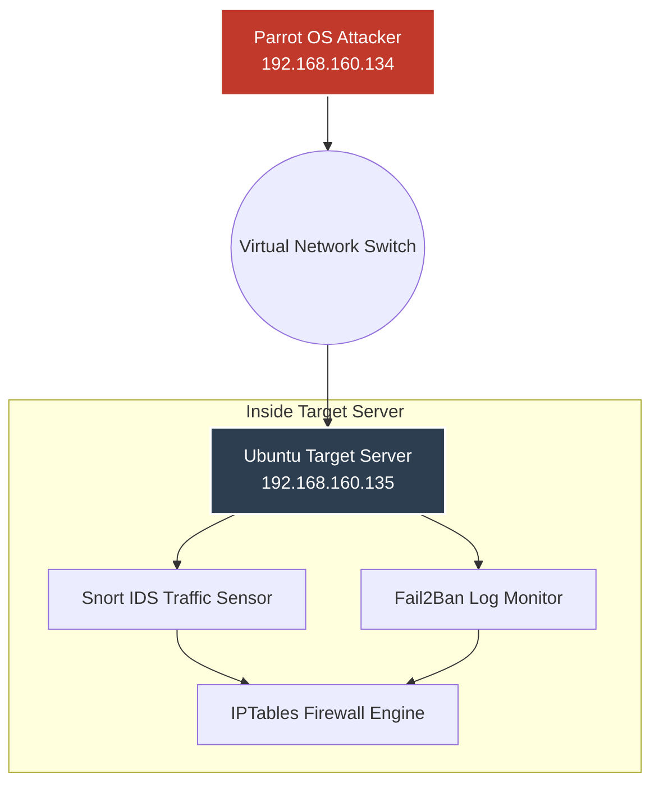

# Network Attack and Defense Simulation Lab

## Project Overview
This project shows the design, setup, and testing of a secure network lab inside a controlled virtual environment. The goal was to run common real-world network attacks (Red Team) against an Ubuntu target server, and configure layered security tools (Blue Team) to detect and block them automatically.

By analyzing system logs, alerts, and service availability, I evaluated the strength of the defense layers against the **CIA Security Triad (Confidentiality, Integrity, and Availability)** framework.

### Project Outcomes
*   **Automated Threat Mitigation:** Integrated log parsing with firewall actions to block brute-force attacks within seconds of detection.
*   **Layered Security Controls:** Set up network-level monitoring alongside host-level defenses to remove single points of failure.
*   **Service Availability:** Configured firewall filtering rules to ensure the target server stayed completely online and responsive during traffic floods.

## Technology Stack
*   **Virtualization Hypervisor:** VMware Workstation
*   **Attacker Node (Parrot OS):** `192.168.160.134` (Used for network scanning, credential attacks, and traffic generation)
*   **Target Node (Ubuntu Server):** `192.168.160.135` (Hosts core services, Snort IDS, and Fail2Ban)
*   **Defensive Tools:** Snort Network IDS, Fail2Ban Log Parser, IPTables/Netfilter Firewall

## Lab Network Topology

```markdown
## Documentation Directory
1. [Phase 1: Lab Design, Sourcing & Specifications](docs/01_lab_design.md)
2. [Phase 2: Attack Simulation Playbook](docs/02_attack_simulation.md)
3. [Phase 3: Defensive Engineering & Logs](docs/03_defensive_engineering.md)
4. [Phase 4: Final Evaluation & Hardening Steps](docs/04_conclusions_and_hardening.md)
```
