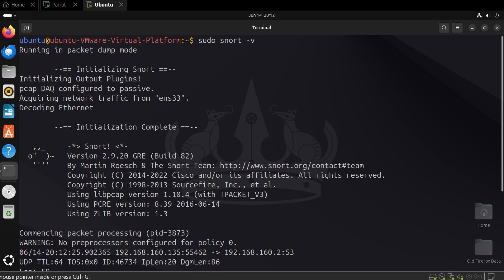
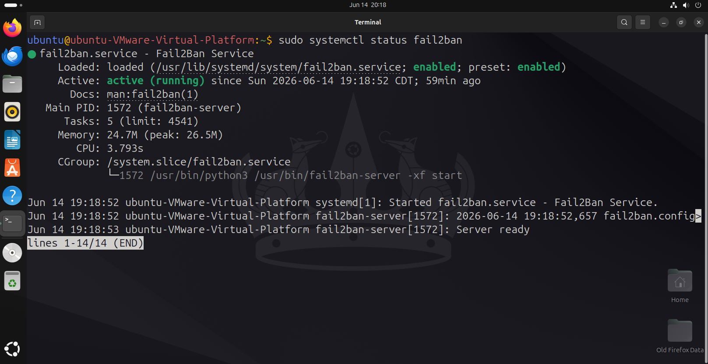
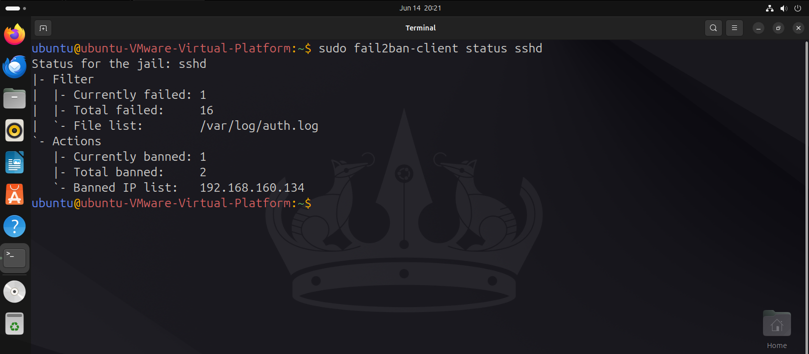

# Phase 3: Defensive Engineering & Logs

This section tracks how the defensive security stack on the Ubuntu Target Server (`192.168.160.135`) detected, logged, and stopped the attacks detailed in Phase 2.

## 1. Network Visibility & Alerts (Snort IDS)
Snort was installed and configured to watch all incoming packets on the main virtual interface.


*Figure 3.1: Verifying that the Snort service is active and listening for traffic.*

### Custom Detection Rule Example (`/etc/snort/rules/local.rules`):
```text
alert tcp any any -> \$HOME_NET 22 (msg:"SECURITY-ALERT: High-Frequency SSH Scan Detected"; flags:S; detection_filter:track by_src, count 5, seconds 10; sid:1000001; rev:1;)
```

### Telemetry & Alerts Captured
When the attacker ran the Nmap scan, the Snort detection engine immediately identified the rapid port mapping patterns and wrote real-time alerts to the log file.


*Figure 3.2: Snort log console capturing the precise attack signatures coming from the Parrot OS machine (192.168.160.134).*

---

## 2. Host Defense & Firewall Automation (Fail2Ban)
To prevent terminal takeover from the password attacks, Fail2Ban was deployed to parse system authentication logs in real-time.


*Figure 3.3: Verification showing the Fail2Ban daemon actively running on the system.*

### Custom Jail Profile Config (`/etc/fail2ban/jail.local`):
```ini
[sshd]
enabled  = true
port     = ssh
filter   = sshd
logpath  = /var/log/auth.log
maxretry = 3
findtime = 600
bantime  = 3600
action   = iptables-multiport[name=SSH, port="ssh", protocol=tcp]
```

### Active Threat Blocking & Caging
When Hydra exceeded 3 failed login attempts, the following automated sequence occurred:
1.  **Log Detection:** Fail2Ban parsed the failed attempts inside `/var/log/auth.log`.
2.  **Firewall Action:** The daemon instantly updated the underlying `iptables` firewall rules.
3.  **Mitigation:** A new firewall rule was added to automatically drop all future network packets coming from the attacker's IP (`192.168.160.134`).


*Figure 3.4: Target terminal view proving Fail2Ban has successfully caged and banned the attacker's IP.*
